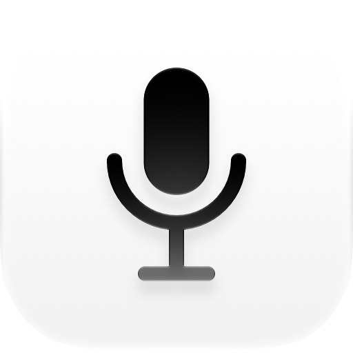

<p align="center"></p>

<h1 align="center">Local Dictation</h1>

<p align="center">Hold a key, speak, release: your words are typed into any app.<br>
Local speech-to-text for macOS. Nothing leaves your Mac.</p>

---

- **Push to talk anywhere.** Hold right ⌥ Option (or another key you pick), speak, let go. The text is pasted where your cursor is: editor, chat, terminal, browser.
- **Private by design.** Recognition runs on your Mac with [MLX](https://github.com/ml-explore/mlx) on Apple Silicon. The recognition server only listens on `127.0.0.1`, and audio is never uploaded.
- **Pick your model.** Whisper, Parakeet and Qwen3-ASR, downloaded in one click and ranked for the language you speak.
- **Your words, spelled right.** A plain-text dictionary teaches it product names and jargon (`GitHub`, `kubectl`, `PostgreSQL`) and fixes words it keeps mishearing.
- **Stays out of the way.** It lives in the menu bar and shows a small pill with a live level meter while you talk. It also puts your clipboard back after pasting.

## Requirements

- A Mac with Apple Silicon (M1 or later), macOS 14 Sonoma or newer
- Xcode Command Line Tools (`xcode-select --install`)
- 2–4 GB of disk space for a model

## Install

```bash
git clone https://github.com/<you>/local-dictation.git
cd local-dictation
./install.sh
```

`install.sh` creates a Python environment in `.venv` (using [uv](https://github.com/astral-sh/uv)), builds the app, and installs it to `~/Applications/Local Dictation.app`. On the first launch:

1. Allow **Microphone** access when macOS asks.
2. Allow **Accessibility** in System Settings → Privacy & Security → Accessibility. Local Dictation needs it to notice the key in other apps and to paste.
3. Settings opens on **Models**. Download one, for example *Whisper Large v3 Turbo*, and you're ready.

The app runs from your clone: it uses `.venv`, `server/` and `models.json` from that folder, so keep the folder where it is. After pulling changes, run `./build.sh` to rebuild.

## Use

| | |
|---|---|
| Hold the key | Starts recording: a live level meter and timer appear at the bottom of the screen |
| Release | Transcribes and pastes the text, followed by a space |
| Quick tap (< 0.3 s), or the key used in a shortcut (⌥→) | Ignored |
| Menu bar icon | Status, microphone, dictionary, Settings (⌘,), logs |

The text goes wherever the cursor is when it's ready, so you can switch windows while you talk. If there's no text field there (you clicked on a list or the desktop), it's in a password field, or Accessibility access is missing, the text stays on the clipboard so you can paste it with ⌘V yourself. The menu also has **Copy Last Dictation**.

## Settings

**General**
- *Hold to dictate*: Right Option, Right Command, Right Control, Right Shift, or Fn/Globe.
- *Record from*: any input device. The choice only affects Local Dictation, not the system input. If the chosen device is unplugged, Local Dictation falls back to the built-in mic.
- *Dictionary*: opens your dictionary file (see below).
- *Keep recent recordings*: saves the last 200 dictations (audio and text) locally. It's off by default and handy for tuning the dictionary.
- *Launch at login*.

**Models**
- *Spoken language*: Auto-detect or a specific language. Naming the language is faster and more reliable on short phrases. The model list is ranked for it.
- Download, switch and delete models. A cancelled download can be restarted at any time.

## Models

| Model | Size | Languages | Notes |
|---|---|---|---|
| **Whisper Large v3 Turbo** | 1.6 GB | 99 | Recommended default: fast and accurate |
| **Whisper Large v3** | 3.1 GB | 99 | Most accurate, best with mixed-language speech and technical terms; about 2× slower than Turbo |
| Parakeet TDT 0.6B v2 | 2.5 GB | English | Fastest, excellent for English |
| Parakeet TDT 0.6B v3 | 2.5 GB | 25 European | Very fast; weak on English words inside other languages |
| Qwen3-ASR 1.7B (8-bit) | 2.5 GB | 30 | Strong on Chinese, Japanese and Korean |
| Qwen3-ASR 0.6B (8-bit) | 1.0 GB | 30 | Lighter Qwen |
| Whisper Small / Base | 0.5 / 0.14 GB | 99 | For low-memory Macs or a quick try; noticeably less accurate |

Models are stored in the standard Hugging Face cache (`~/.cache/huggingface/hub`), so models you already have there are picked up. The catalog lives in [`models.json`](models.json). To add a model, add an entry with one of the supported engines (`whisper`, `parakeet`, `qwen`).

Some notes from testing on mixed Russian and English dictation (Apple M4 Max). Whisper Large v3 with the dictionary hint had the fewest errors and kept English terms in Latin script. Turbo was about 2× faster with slightly more errors. Parakeet and Qwen3-ASR were fast but tended to transliterate English words. On pure English speech, Parakeet v2 is a great choice.

## Dictionary

`~/Library/Application Support/Local Dictation/dictionary.txt`. Open it from the menu or Settings. Changes apply to the next dictation.

```text
# One term per line: passed to the model as a spelling hint, and the output
# is normalised to this spelling ("git hub", "Github" -> "GitHub").
GitHub
PostgreSQL

# "heard => written" replaces a phrase the model keeps getting wrong.
kube control => kubectl
```

Whisper and Qwen use the terms as a hint while recognising. Parakeet doesn't take hints, but the normalisation and replacements still apply.

## Privacy

- Audio is recorded only while you hold the key, and it's sent only to the local server on `127.0.0.1`.
- The server runs offline (`HF_HUB_OFFLINE=1`). The network is used only when you download a model from Settings.
- History is off by default. When it's on, files stay in `~/Library/Application Support/Local Dictation/history/`.

## Troubleshooting

- **Nothing happens when I hold the key.** Check Accessibility access (the menu shows a warning while it's missing). If you rebuilt the app and it stopped working, turn Local Dictation off and on again in the Accessibility list.
- **“No model”**: download one in Settings → Models.
- **Fn key opens the emoji picker**: set System Settings → Keyboard → “Press 🌐 key to” → “Do Nothing”.
- **Logs**: menu → Show Logs (`~/Library/Logs/Local Dictation/`): `app.log` (keys, mic, pastes), `server.log` (recognition), `downloads.log`.
- **Check the mic without dictating**: `"$HOME/Applications/Local Dictation.app/Contents/MacOS/LocalDictation" --probe-mic` (or `--probe-hud` to watch the level meter for 4 s), then look in `app.log`. `--probe-focus` logs what has keyboard focus, and `--probe-deliver "text"` pastes a test text the way a dictation would. Start these with `open -n "$HOME/Applications/Local Dictation.app" --args …` so they run with the app's Accessibility access.
- **See any UI state without triggering it**: the same binary with `--demo <state>`. The states are `recording`, `transcribing`, `noModel`, `copied`, `micFailed`, `menu-noax` and others; [`app/Demo.swift`](app/Demo.swift) has the full list.

## How it works

```
Local Dictation.app (Swift, menu bar)            server/asr_server.py (Python, MLX)
  hotkey down  -> record mic (AudioQueue, 16 kHz)
  hotkey up    -> POST /transcribe (WAV)  ----->  trim silence -> model -> drop hallucinations
  paste via clipboard + ⌘V  <---------------  {"text"}     -> dictionary fixes
```

- `app/`: the Swift app: hotkey, recording, paste, HUD (`App.swift`, `Audio.swift`, `Paste.swift`), model downloads (`Models.swift`) and the SwiftUI settings (`Settings.swift`). Built with plain `swiftc`, no Xcode project.
- `server/`: the recognition server and dictionary logic.
- `models.json`: the model catalog.
- `build.sh`: compiles, signs and installs the app. It signs with a self-signed certificate kept in its own keychain (`~/Library/Application Support/Local Dictation/signing/`), so macOS permissions survive rebuilds.
- `assets/`: the layered Liquid Glass icon (`AppIcon.icon`, edit it in Icon Composer) and its compiled form (`compile_icon.sh`).

## License

[MIT](LICENSE)
